Factory is how we build software at McWestling. An idea goes in as a scribbled note and comes out as a finished, checked change to a real product. Coding agents, which are AI programs that read and write code by themselves, do the building. A person makes every call that needs judgement.

This page is for anyone who has heard of coding agents and wonders what it looks like to run real work through them. You don't need to use any of the tools named here to follow along.

Here is what it covers:

- [Why we built it](#why-we-built-it)
- [How an idea becomes a finished change](#how-an-idea-becomes-a-finished-change), in six steps, following one example
- [How the work gets checked](#how-the-work-gets-checked)
- [What it's made of](#what-its-made-of)
- [Where it's going](#where-its-going)
- [Takeaways](#takeaways) and where to [learn more](#learn-more)

## Why we built it

Software work is a mix of two kinds. A small part is deciding: what to build, how it should behave, how the pieces fit together. The rest is wiring and plumbing: connecting those pieces, following the patterns already in place, getting the details right. Both matter. Only the first needs a person.

Coding agents are now good at the second kind, as long as someone tells them clearly what to do and checks what comes back. So we wanted to spend our thinking on the hard parts, the decisions and the architecture, and hand over the rest.

Factory is how we do that. Every idea goes through the same steps. At the steps that need judgement, Factory stops and asks a person. At the others, it keeps going.

<figure>

<figcaption>Most of the work runs straight through to the agents and comes out built. The pieces that are really decisions are lifted off for a person to settle, then go back on the line.</figcaption>
</figure>

There were three more reasons:

- **One person can run it.** A large organisation spends most of its effort getting people to agree. McWestling is small, and Factory lets one person make the decisions and still ship steadily.
- **Time.** The work carries on while we're away from the desk, which gives us more control over where our time goes.
- **Curiosity.** We wanted to know how far this could go, and the way to find out was to build it and use it every day.

## How an idea becomes a finished change

An idea passes through six steps. At three of them, a person decides.

<figure>
<picture data-live>
<source media="(max-width: 40rem)" srcset="public-page/journey-tall.svg">

</picture>
<figcaption>An idea moves down the line and leaves each step in a new shape: a note, a map, a stack of small tasks, a built change, a checked change, a finished one. <b>1</b> Capture, <b>2</b> Triage, <b>3</b> Refine, <b>4</b> Implement, <b>5</b> Review, <b>6</b> Closeout. A lit lamp marks a step where a person decides.</figcaption>
</figure>

To make the steps concrete, we'll follow one idea through all six, in a made-up product.

Potluck is a small app for friends who take turns hosting dinners. A host invites guests, and each guest says whether they're coming and what they'll bring. Its tasks are kept in Linear, a task tracker, where each one gets a number like ABC-101.

One evening a host notices that two guests forgot the date. That's the idea we'll follow.

###  1. Capture

Ideas turn up at bad moments, so getting one down has to cost nothing. An idea might be a flaw in the software, a new feature, or a question to explore. It might arrive as a photo of a sticky note, a voice note, a chat message, an email, or a task typed straight into Linear.

<figure>

<figcaption><b>1</b> A sticky note with a feature idea. <b>2</b> A voice note. <b>3</b> A flaw someone noticed, typed straight into Linear. <b>4</b> A question in a chat message. <b>5</b> An email.</figcaption>
</figure>

Whatever the form, an agent reads it and files it. Our host's sticky note says "remind people before the dinner!!". Capture files it as ABC-101, *Send reminders to guests before dinner events*, in a pile of new ideas waiting to be sorted.

<figure>

<figcaption><b>1</b> Our sticky note, on the heap. <b>2</b> Capture reads it. <b>3</b> The same idea, written out and filed.</figcaption>
</figure>

###  2. Triage

The pile gets sorted with you. For each idea, the agent says what it thinks should happen, and you choose: build it now, plan it further, or drop it. ABC-101 sounds simple, but nobody has said how guests are reminded, or when. So you choose to plan it further.

An idea that needs planning gets a map: a project in Linear that holds one goal, the questions still open on the way to it and, later, the tasks to build. The idea comes from Matt Pocock's [wayfinder skill](https://github.com/mattpocock/skills/tree/main/skills/engineering/wayfinder), which Factory's planning is built on. The agent starts a map called *Dinner reminders* and moves ABC-101 into it. For now the map says where we want to end up, and not yet how to get there.

<figure>

<figcaption><b>1</b> The idea as it was captured. <b>2</b> You and the agent decide what happens to it. <b>3</b> A new map, <i>Dinner reminders</i>: the idea at one end, the goal at the other, the way between unknown.</figcaption>
</figure>

###  3. Refine

This is where most of the thinking happens. The agent turns the unknown part of the map into questions, and you settle them one at a time. This map needs one: ABC-103, *Decide how guests are reminded*. The agent recommends email, since Potluck already sends invitations that way. You answer: "Email only, at 9am the day before. The host can turn it off for a dinner."

The agent then slices the work into small tasks on the map, each clear enough to build without asking anything more. ABC-104 lets a host turn reminders on or off for a dinner. ABC-105 emails the guests, and waits for ABC-104 to be finished first.

<figure>

<figcaption><b>1</b> The map, with the way still unknown. <b>2</b> You settle its questions, one at a time. <b>3</b> Small tasks, ready to build.</figcaption>
</figure>

###  4. Implement

Each small task goes to an agent, which builds it, checks its own work and opens a pull request: a proposed change to the code, ready for someone to look at. Nobody has to watch.

<figure>

<figcaption><b>1</b> A small, clear task. <b>2</b> An agent builds it. <b>3</b> A pull request (PR).</figcaption>
</figure>

###  5. Review

A second agent, which took no part in the building, reads the pull request and works with the first agent until it has no complaints left. Only then are you asked to look. You read the change and either merge it, which makes it part of the product, or send it back.

<figure>

<figcaption><b>1</b> A pull request. <b>2</b> A reviewer agent goes through it, then you do. <b>3</b> A change that has been checked and accepted.</figcaption>
</figure>

###  6. Closeout

After the merge, an agent tidies up. It marks the task done, confirms that each thing the task asked for was delivered, and runs any steps that had to wait for the merge. It ends with a verdict, "Good to close" or "Not yet", and suggests what to pick up next.

<figure>

<figcaption><b>1</b> A merged change. <b>2</b> An agent confirms everything was delivered. <b>3</b> Finished.</figcaption>
</figure>

## How the work gets checked

Handing work to agents only makes sense if you can trust what comes back, and an agent saying "done" is not enough.

Each project declares its own checks: the tests and other commands that have to pass. A part of Factory called Verifier runs them at every point where a mistake could slip through:

- while the agent works, on the same computer;
- before the change can go up for review, where it is refused unless it carries proof that the checks passed;
- on the pull request itself;
- and again after the merge, where a failure is filed as a new task.

Then the reviewer agent reads the change. By the time a person is asked to look, the work has passed everything a machine can check. That leaves the person with the one question a machine can't answer: is this the right change?

## What it's made of

Factory is three parts of its own, joined to three tools made by other people.

<figure>
<picture>
<source media="(max-width: 40rem)" srcset="public-page/map-tall.svg">

</picture>
<figcaption>Filled parts are Factory's own. Outlined parts are tools it connects. The loop closes with you.</figcaption>
</figure>

Factory's own parts:

- **[Skills](https://github.com/mcwestling/factory#skills):** written instructions for a coding agent, one for each step above. They are the heart of Factory, and you can use them without the other two parts.
- **[Delegator](https://github.com/mcwestling/factory/tree/main/packages/delegator#readme):** starts the work. When a task in Linear is ready, Delegator opens a workspace on your own computer and puts an agent to work in it.
- **[Verifier](https://github.com/mcwestling/factory/tree/main/packages/verifier#readme)** <small>Coming soon</small>**:** runs each project's checks, as described above.

The tools it connects:

- **[Linear](https://linear.app):** a task tracker. Every idea and task lives here.
- **[Orca](https://onorca.dev):** an app that runs several coding agents side by side, each in its own copy of the code.
- **[GitHub](https://github.com):** where the code is kept, and where pull requests are reviewed and merged.

Factory also builds on [Matt Pocock's skills](https://github.com/mattpocock/skills) for research, design, prototyping and testing.

## Where it's going

Factory changes every week. Three things are ahead, from nearest to furthest:

- **Rolling out now:** when a problem gets past the checks, Factory files a task against itself to close the gap, so the same mistake can't get through twice.
- **Planned:** review starts by itself as soon as the checks pass, with nobody having to ask for it.
- **Still being weighed:** letting small, low-risk changes merge with very little human involvement. We haven't decided whether to do this.

## Takeaways

- People decide; agents do the wiring and plumbing.
- Every idea takes the same six steps, and a person is brought in at the three that need judgement.
- Nothing reaches a person until it has passed every check a machine can run.

## Learn more

- [Factory on GitHub](https://github.com/mcwestling/factory) has everything: the skills, Delegator and Verifier. It's built for McWestling, not as a product: there is no support, and anything may change. To stand up the same thing for yourself, fork the repo and follow its README.
- [Matt Pocock's skills](https://github.com/mattpocock/skills) are the ones Factory builds on.
- [About McWestling](https://mcwestling.com/about/) says who we are.
