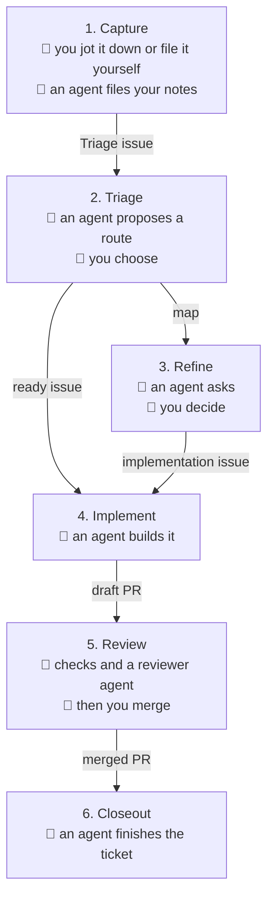

# How it works

Factory takes an idea from a jotted note to a merged change in six steps. You, the human, make every decision. Coding agents do the legwork in between.

## What a map is

Factory keeps its plans in [Linear](https://linear.app), an issue tracker, and adds no tool of its own. Its main idea is the **map**, and a map is a Linear project used in a particular way.

Some goals are too big or too unclear to hand to an agent: you can say where you want to end up, but not how to get there. A map holds one of those goals. It is incomplete on purpose. It starts as a destination and a few open questions, and fills in as you answer them.

- **The project's description is the map.** It names the destination, lists each decision made so far with a link, sketches the work nobody can pin down yet, and says what is out of scope.
- **The project's issues are the map's tickets.** There are two kinds, below. They are flat: no sub-issues.
- **Blocking relations set the order.** Linear's "blocks" and "blocked by" links between issues say what has to happen first.
- **The project's status says how far along the map is:** just created, planned out, being worked, or done.

A small, clear idea never needs a map. It becomes a single issue with no project.

## Words to know

| Word | What it means | In Linear |
| --- | --- | --- |
| **Triage** | New ideas nobody has reviewed yet. Also the step that reviews them. | Issues in the `Triage` status |
| **Map** | The plan for one goal, as above | A project |
| **Decision ticket** | One open question on a map. Nothing gets built from it; answering it is the work. | An issue in the project with a `wayfinder:` label. The answer is a comment on it. |
| **Implementation issue** | One piece of build work, written clearly enough for an agent to pick up, and small enough for one pull request | An issue with no `wayfinder:` label, in a map's project or on its own |
| **Ready issue** | An implementation issue an agent can start now | In the `Todo` status, with nothing blocking it |
| **Slice** | To cut settled work into implementation issues. Each one is also called a slice. | New issues in the project |
| **Product** | The app or site an issue belongs to | A label on the issue, and an initiative that holds the product's maps |
| **Delegate** | To hand an issue to an agent | Linear's delegate field on the issue, or a command you type to an agent yourself |
| **Closeout** | The tidying after a merge: marking the issue done and checking nothing is left over | The issue moves to `Done` |

"Issue" and "ticket" mean the same thing. A **skill** is a set of written instructions an agent follows; each step below has one. The status and label names are the ones this repo uses, set in its [settings file](issue-tracker.md).

## The flow

## The six steps

1. **Capture.** Every idea starts as an issue in Triage. You can file one yourself, straight into the tracker. Or you can jot ideas on sticky notes, or say them out loud, and hand the pile to an agent: it writes each one up in your own words, asks about anything it can't read, and decides nothing.
2. **Triage.** An agent goes through the queue with you. It looks up related tickets and code, and proposes a route for each idea; you make the call. An idea you want leaves one of two ways. If it is small and clear, it becomes a ready issue an agent can build straight away. If it needs planning, it goes into a map, to be planned in the next step.
3. **Refine.** An agent works a map with you. You settle its decision tickets one per session: the agent does the reading and recommends an answer, and you decide. Once the decisions behind a piece of work are settled, the agent slices it into implementation issues and shows you the list before filing them.
4. **Implement.** You hand one implementation issue to an agent. It writes a failing test first where it can, builds the change, runs the repo's checks, and opens a draft pull request.
5. **Review.** The repo's checks run on the draft. A reviewer agent, a second agent that can read but not edit, can check the draft too: the agent that built it fixes what the reviewer finds, for up to three rounds. In a repo with PR autopilot, the pull request is marked ready automatically once the checks pass. Then you review it and merge it. No agent ever merges.
6. **Closeout.** After the merge, an agent marks the issue done, ticks off what landed, runs the after-merge steps it can, and tells you what is still open. It ends with a verdict, "Good to close" or "Not yet", and suggests the next ticket.

## A worked example

Potluck is a made-up app for planning shared dinners. Here is one idea going all the way through.

**1. Capture.** You could type this one into the tracker yourself. This time it is a sticky note, which says:

> remind people before the dinner!!

The agent files it in Triage as `ABC-101 Remind guests before a dinner`, with the note quoted word for word.

**2. Triage.** The agent finds that Potluck sends no reminders today, and proposes a new map. You agree. It leaves this comment on the ticket:

> 2026-03-02 — Triage: New map. Reminding guests needs a decision about how and when, and more than one PR. Map: Dinner reminders.

**3. Refine.** The map gets one decision ticket, `ABC-103 Decide how guests are reminded`. The agent asks: email or push notification, and how long before? It recommends email, since Potluck already sends invitations that way. You answer:

> Email only, at 9am the day before. The host can turn it off for a dinner.

With that settled, the agent slices the work in two:

- `ABC-104 Let a host turn reminders on or off for a dinner`
- `ABC-105 Email guests a reminder the day before a dinner`, which waits for `ABC-104`

**4. Implement.** You hand `ABC-104` to an agent. It opens a draft pull request titled `Let a host turn reminders on or off for a dinner (ABC-104)`.

**5. Review.** The checks pass. The reviewer agent finds that turning reminders off doesn't survive editing the dinner; the building agent fixes it and adds a test. The reviewer's second verdict is `happy`. You read the pull request and merge it.

**6. Closeout.** The agent marks `ABC-104` done and reports:

> **Verdict:** Good to close
>
> **Suggested next ticket:** ABC-105 Email guests a reminder the day before a dinner

You hand over `ABC-105`, and steps 4 to 6 run again.

## Where each step lives

Each step has a skill: [`do-post-its`](../skills/do-post-its/SKILL.md), [`do-triage`](../skills/do-triage/SKILL.md), [`do-refine`](../skills/do-refine/SKILL.md), [`do-implement`](../skills/do-implement/SKILL.md), [`do-review`](../skills/do-review/SKILL.md) and [`do-closeout`](../skills/do-closeout/SKILL.md). PR autopilot is described in [autopilot.md](autopilot.md).
