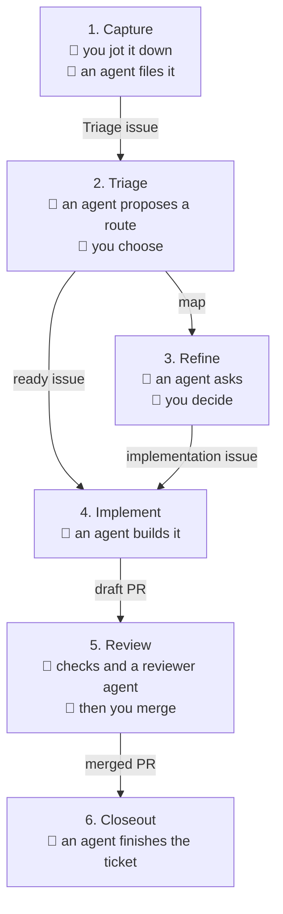

# How it works

Factory takes an idea from a jotted note to a merged change in six steps. You, the human, make every decision. Coding agents do the legwork in between.

## The six steps

1. **Capture.** You jot ideas down on sticky notes or say them out loud. An agent writes each one up in your own words as a ticket in Triage, the queue of things nobody has reviewed yet. It asks about anything it can't read, and decides nothing.
2. **Triage.** An agent goes through the queue with you. It looks up related tickets and code, and proposes a route for each idea; you make the call. An idea you want leaves one of two ways. If it is small and clear, it becomes a ready issue an agent can build straight away. If it needs planning, it goes into a **map**: a project that holds one goal, the questions still open on the way to it, and the work once it is settled.
3. **Refine.** An agent works a map with you. Each open question is a **decision ticket**, and you settle them one per session: the agent does the reading and recommends an answer, and you decide. Once the decisions behind a piece of work are settled, the agent **slices** it: it cuts the work into implementation issues, each small enough for one pull request, and shows you the list before filing them.
4. **Implement.** You hand one implementation issue to an agent. It writes a failing test first where it can, builds the change, runs the repo's checks, and opens a draft pull request.
5. **Review.** The repo's checks run on the draft. A reviewer agent, a second agent that can read but not edit, can check the draft too: the agent that built it fixes what the reviewer finds, for up to three rounds. In a repo with PR autopilot, the pull request is marked ready automatically once the checks pass. Then you review it and merge it. No agent ever merges.
6. **Closeout.** After the merge, an agent marks the issue done, ticks off what landed, runs the after-merge steps it can, and tells you what is still open. That is **closeout**. It ends with a verdict, "Good to close" or "Not yet", and suggests the next ticket.

## A worked example

Potluck is a made-up app for planning shared dinners. Here is one idea going all the way through.

**1. Capture.** A sticky note says:

> remind people before the dinner!!

The agent files it in Triage as `ABC-101 Remind guests before a dinner`, with the note quoted word for word.

**2. Triage.** The agent finds that Potluck sends no reminders today, and proposes a new map. You agree. It leaves this comment on the ticket:

> 2026-03-02 — Triage: New map. Reminding guests needs a decision about how and when, and more than one PR. Map: Dinner reminders.

**3. Refine.** The map gets one decision ticket, `ABC-103 Decide how guests are reminded`. The agent asks: email or push notification, and how long before? It recommends email, since Potluck already sends invitations that way. You answer:

> Email only, at 9am the day before. The host can turn it off for a dinner.

With that settled, the agent slices the work in two:

- `ABC-104 Let a host turn reminders on or off for a dinner`
- `ABC-105 Email guests a reminder the day before a dinner`, which waits for `ABC-104`

**4. Implement.** You hand `ABC-104` to an agent. It opens a draft pull request titled `Let a host turn reminders on or off for a dinner (ABC-104)`.

**5. Review.** The checks pass. The reviewer agent finds that turning reminders off doesn't survive editing the dinner; the building agent fixes it and adds a test. The reviewer's second verdict is `happy`. You read the pull request and merge it.

**6. Closeout.** The agent marks `ABC-104` done and reports:

> **Verdict:** Good to close
>
> **Suggested next ticket:** ABC-105 Email guests a reminder the day before a dinner

You hand over `ABC-105`, and steps 4 to 6 run again.

## Where each step lives

Each step is a skill, a set of written instructions an agent follows: [`do-post-its`](../skills/do-post-its/SKILL.md), [`do-triage`](../skills/do-triage/SKILL.md), [`do-refine`](../skills/do-refine/SKILL.md), [`do-implement`](../skills/do-implement/SKILL.md), [`do-review`](../skills/do-review/SKILL.md) and [`do-closeout`](../skills/do-closeout/SKILL.md). PR autopilot is described in [autopilot.md](autopilot.md).
